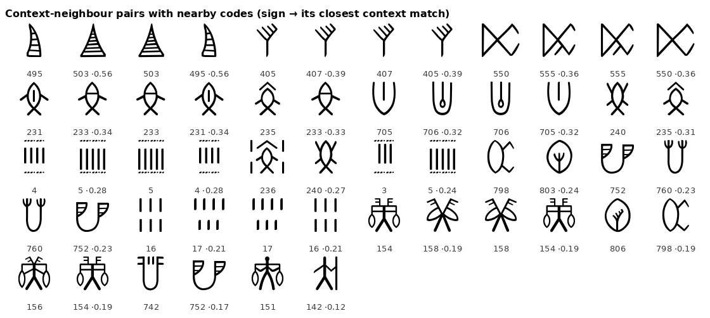

# Indus sign statistics

A small, reproducible look at the structure of the Indus script (c. 2600–1900 BCE): how its signs are
distributed, where they sit in a text, how it compares with real languages and with a non-linguistic
code cut to the same size, and which signs keep the same company.

**This is not a decipherment.** No sign is given a sound or a meaning here. Every number below is
computed from the data, and every reading of any sign stays open.

Commissioned and directed by Capt. Anil Sharma; implementation with an AI assistant (Claude, Anthropic).



## Findings

All figures come from `results/` and are rebuilt by `./run.sh`.

1. **Corpus.** 2,543 inscribed objects, which reduce to 1,902 distinct sign sequences once repeated
   texts (multiple impressions, tablet series) are merged. 591 sign types; mean length 4.65 signs,
   longest 17. 36% of sign types occur only once, and the 10 commonest signs make up a third of all
   occurrences.
2. **Signs keep places.** One sign (code 740, the "jar") makes up about 11% of all occurrences and
   stands at the same end of a text in 70% of its uses. It almost never stands at the other end.
   Several other signs are just as tied to one end or to the middle.
3. **Between a language and a code.** Against same-size samples of Vedic Sanskrit (syllables),
   Old Tamil (aksharas), English (words) and chess openings (moves):
   - Indus signs are more tied to their position than any of the three languages, about as much as
     chess moves (position information 0.36, against 0.10–0.22 for the languages and 0.33 for chess).
   - Once position is held fixed, the order of signs still carries structure at the level of Old
     Tamil (22% below a slot-preserving shuffle, against 24% for Tamil, 18% for Sanskrit, 12% for
     English and 27% for chess).
   - Signs rarely repeat within a text (4.4% of texts), close to English words (4.6%) and below the
     syllable scripts (8–13%). This fits signs that stand for words more than for single sounds.
4. **One very predictable end.** At one end of a text five signs fill 59% of the slot, led by the jar.
   Old Tamil phrases show a similarly predictable end (their recurring suffixes). The Indus pattern
   fits a closing marker such as a suffix, but a title or a classifier would produce the same shape,
   and so does the opening of a chess game.
5. **Signs that look alike behave alike.** Grouping signs by the neighbours they keep, 27 of 94
   common signs have as their closest match a sign with a catalogue code within 10 of their own,
   against 2.2 expected by chance (p ≈ 0.002, 500 shuffles). The catalogue numbers group signs by
   shape, and the rendered pairs show the same shape families: stroke counts 3/4/5 (number-like), the
   fish with and without added marks, cone, branch, jar and figure variants. Modifiers change a sign
   without moving it out of its slot.

6. **The text barely depends on the picture.** Pairing each distinct text with the animal carved on
   its object (the dataset's own iconography labels; six motifs with at least 25 texts), the
   sign-motif mutual information is 0.188 bits against 0.175 ± 0.007 for shuffled motifs, only
   1.9 sd above chance. The label "Bull1" alone carries 913 of the 1,134 texts (most likely the one-horned bull, the commonest
   seal animal; the dump does not define its labels). Picture and
   text carry largely separate information, as expected if the animal is an emblem and the text a
   name or title.

7. **Later Hindu sacred symbols do not resemble the signs more than other traditions' symbols do.**
   A pre-registered blind test ([`blind/PREREGISTRATION.md`](blind/PREREGISTRATION.md)) drew 10 Hindu
   sacred symbols and 10 each from Christian, Chinese and Egyptian tradition in one line style, and
   let a computer find each one's closest Indus sign by skeleton shape. Mean distance: Hindu 2.30 px,
   Christian 2.27, Chinese 2.28, Egyptian 1.98; one-sided permutation p = 0.73. Under the rule fixed
   in advance this is **no excess resemblance found**. Random signs from real pictographic scripts
   match about as well. Simple shapes (a circle with a cross, three lines) find look-alikes in every
   tradition ([`blind/matches.png`](blind/matches.png)). This tests the script's signs only: the seal
   pictures, where the scholarly case for continuity rests, are not in the data.

The same grouping method was first run on Old Tamil, where the answer is known. It recovers letters
that share a consonant strongly (11.8 sd above chance) and letters that share a vowel weakly (2.4 sd).
It works, but only partly.

## Limits

- **Direction.** The sign order is taken as stored. That the stored start is the reading end (the
  script is mostly read right to left) is an inference from the jar sign's known text-final place,
  not a field in the data.
- **Sanskrit.** The syllable splitter attaches final consonants to the last syllable, which scatters
  Sanskrit's case endings. The Sanskrit grammar-shape row is not a fair test until it splits by
  written akshara.
- **Genre.** The language samples are verse and prose cut to the Indus lengths, not seal-like texts
  (names, titles, formulae). A genre-matched comparison, for example Mesopotamian seal inscriptions,
  has not been done.
- **Entropy.** Plug-in estimates on about 9,000 tokens are biased low. Only comparisons between
  samples of the same size, and against shuffles of the same text, are meaningful.
- **Corpus choices.** Identical sequences are merged; the line-break marker is removed; 45 rare
  signs have no glyph in the font and show as "?". The sign catalogue (the corpus's own numbering)
  decides what counts as one sign, and other catalogues split and merge signs differently.

## Reproduce

```
./fetch_data.sh   # downloads all inputs from upstream, pinned to commits, sha256-checked
./run.sh          # rebuilds everything in results/
```

Needs Python 3 with `numpy` and `Pillow`. Every script runs offline once the data is fetched.

| script | output |
|---|---|
| `src/structural.py` | `results/structural.txt`: counts, positions, pairs, entropy against shuffles |
| `src/compare.py` | `results/compare.md`: the same-size comparison table |
| `src/grammar_groups.py` | `results/grammar-and-groups.md`: ends test and context groups |
| `src/shape_family.py` | `results/shape-family.txt`: code-distance test |
| `src/motif.py` | `results/motif.txt`: text against the carved animal |
| `src/render.py` | `results/*.png`: sign sheets |
| `blind/symbols.py`, `blind/match.py` | `blind/drawings.png`, `blind/result.txt`, `blind/matches.png`: the blind symbols test |

## Data and credit

No data is redistributed here; `fetch_data.sh` downloads each file from its source.

| input | source | licence |
|---|---|---|
| Indus sign sequences and sign font | [yajnadevam/indus-website](https://github.com/yajnadevam/indus-website) @ `2434249` | GPL-3.0 |
| Rig Veda lines (IAST) | [Equationist/indusscript-decipherment-stats](https://github.com/Equationist/indusscript-decipherment-stats) @ `90c70d8` | Unlicense |
| Tirukkural (original lines only) | [tk120404/thirukkural](https://github.com/tk120404/thirukkural) @ `cf3ff6c` | Apache-2.0 |
| Chess openings | [lichess-org/chess-openings](https://github.com/lichess-org/chess-openings) @ `a6189a3` | CC0-1.0 |
| *Pride and Prejudice* | [Project Gutenberg #1342](https://www.gutenberg.org/ebooks/1342) | public domain (US) |

The Indus sequences follow the Interactive Corpus of Indus Texts (ICIT) of Bryan K. Wells and Andreas
Fuls, which rests on the corpora of Iravatham Mahadevan (1977) and Asko Parpola and colleagues (CISI).
This study uses only the sign sequences, sites and object types. The dataset's maintainer has proposed
a reading of the script; this study neither uses nor evaluates it.

Related statistical work: Rao et al., *Science* 324 (2009); Farmer, Sproat and Witzel (2004);
Nair, arXiv:2604.17828 (2026); Tiwari, NLP4DH 2026.

## Licence

Code: GNU Affero General Public License v3.0 (`LICENSE`). Copyright © 2026 Capt. Anil Sharma.
Rendered sign sheets in `results/` are drawn with the GPL-3.0 font above.
